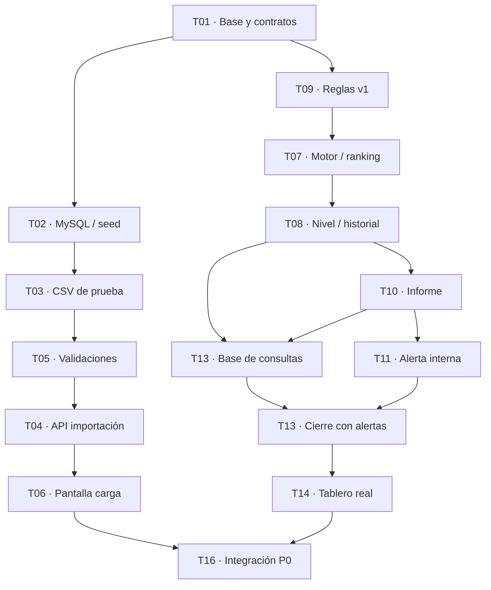

# Tareas del primer prototipo

Contexto compartido del equipo, tomado del plan de tareas de DOCUMENTACION. Sirve para saber qué entra en la primera entrega, quién la hace y de qué depende.

Las reglas del índice, los contratos y la estructura del código viven en otros archivos. Si el acuerdo cambia, hay que actualizar este documento junto con tipos, consumidores y pruebas.

- [Alcance, casos de uso y reglas](https://docs.google.com/document/d/1aYIW8zZtLqwAlr5YQnljINkdmViz5vhH7_XVnLjOpXs/edit)
- [Contratos y pruebas](contratos-prototipo.md)
- [Reglas CU02](cu02-reglas.md)
- [Arquitectura y API](arquitectura.md)
- [Guía T01](t01-base.md)
- [Guía T02](t02-persistencia.md)
- [Casillas P0 en GitHub](https://github.com/eros7676/burnout-index-system/issues/2)

## Objetivo de la primera entrega

El prototipo identifica indicadores de posible sobrecarga laboral con datos ficticios. Next.js, TypeScript, Prisma y MySQL. Los parámetros v1 son demostrativos: el sistema no diagnostica burnout.

P0 es la demo local mínima. El circuito que tiene que quedar andando es:

1. Importar y validar un CSV.
2. Confirmar y guardar en una transacción.
3. Calcular el índice, clasificar y conservar el historial.
4. Armar el informe individual.
5. Generar una alerta interna solo si el nivel vigente es ALTO.
6. Mostrar esos resultados en el tablero.

P1 (correo simulado, permisos de demostración y auditoría ampliada) no bloquea esa demo. El sistema final, fuera de este plan, agrega XLSX, exportaciones, correo real, CRUD completo, vista del empleado y editor web de reglas.

Una tarea se cierra cuando se cumple su criterio de “Listo cuando”, se respeta el contrato, hay pruebas relevantes y pasó la revisión indicada. Las ramas salen de `main` con el nombre `feature/TXX-descripcion` y vuelven por pull request. Cada integrante corrige su módulo.

## Tareas imprescindibles (P0)

### T01 · Base del proyecto y contratos TypeScript

Responsable: Gonzalo · revisión Eros. Depende de: ninguna.

Inicializar Next.js App Router + TypeScript, scripts, `.env.example` y la estructura compartida. Publicar todos los tipos, rutas y firmas de Contratos y pruebas, más mocks de sus respuestas. Eros revisa fórmulas y estados antes de integrar.

Listo cuando: `npm install`, `npm run build` y las pruebas base funcionan; todos importan los mismos tipos y nadie los redefine.

### T02 · Persistencia Prisma/MySQL y datos semilla

Responsable: Gonzalo. Depende de: T01.

Modelar empleados, equipos, responsables, importaciones, registros versionados, configuraciones, evaluaciones, alertas y `ProcessingJob`. Definir claves únicas, vigencia e integridad. Dejar migraciones, seed ficticio y comandos en el README. Incluir la trazabilidad mínima de P0. `IntentoNotificacion` y la auditoría ampliada quedan para P1.

Listo cuando: la base se reconstruye desde cero y conserva empleados, registros, evaluaciones y alertas entre reinicios.

### T03 · Plantilla de datos y archivos de prueba

Responsable: Santiago + Alfonso. Depende de: T01; T02 para usar los IDs reales del seed.

Crear `templates/indicadores.csv` con las nueve columnas obligatorias y las dos opcionales si hacen falta. Datos ficticios para 50 empleados y al menos dos semanas. Incluir el ejemplo contractual y los casos BAJO, MEDIO, ALTO, primera semana INCOMPLETA, hueco y carga fuera de orden. Sumar archivos inválidos, idénticos y conflictivos. XLSX queda para el sistema final.

Listo cuando: el CSV usa los mismos empleados y tipos que la base y permite reproducir los cuatro escenarios.

### T09 · Configuración inicial y versionado de reglas

Responsable: Eros define · Gonzalo persiste. Depende de: T01, T02.

Sembrar v1 efectiva desde 2026-01-05: HE=8, DS=6, CT=0,35, VP=10; pesos 0,30 / 0,30 / 0,25 / 0,15; límites 40 / 70 y dos semanas. Validar la configuración y habilitar nuevas versiones por script de Eros y Gonzalo, con reevaluación. Sin editor web.

Listo cuando: una regla inválida se rechaza y cada evaluación conserva el identificador de la versión aplicada.

### T05 · Validaciones de importación y duplicados

Responsable: Santiago · revisión Eros. Depende de: T01, T03; T02 para cotejar registros.

Validar campos obligatorios, empleado existente, semana y fechas reales, números no negativos y la relación `tareas_vencidas ≤ tareas_pendientes ≤ tareas_activas`. Detectar duplicados internos, un archivo ya importado y un conflicto por el mismo empleado y período. Devolver el error con fila y campo.

Listo cuando: un solo error impide confirmar todo el lote y la reimportación idéntica no duplica información.

### T07 · Motor matemático CU02 y ranking

Responsable: Eros. Depende de: T01, T09 (definiciones acordadas).

Implementar `calcularEvaluacion` conforme a CU02, separando puntuación y clasificación del acceso a la base. CT usa el total semanal, incluidas las completadas. `score_i = min(100, 50 × Xi / Ui)`. Redondear solo el índice final. Ranking por contribución, con desempate HE, DS, CT, VP. Comparar el índice contractual redondeado.

Listo cuando: hay tests de normalización, valores límite, ranking, división por cero y el ejemplo de índice ≈ 83,71. La fórmula se prueba sin base de datos.

### T04 · API CU01 de validación y confirmación CSV

Responsable: Santiago · revisión Gonzalo. Depende de: T02, T03, T05. La tabla del plan también incluye T01.

Implementar las rutas de validación, confirmación, cancelación, job y reintento de Contratos y pruebas. Validar genera una vista previa temporal. Confirmar revalida y guarda en una transacción, y después solicita T08, T10 y T11. Rechazar conflictos y no sobrescribir. Procesar a los afectados y al sucesor inmediato si existe.

Listo cuando: un CSV válido se confirma una sola vez, un CSV inválido no modifica la base y la API entrega estado y cantidades.

### T08 · Clasificación CU02, evaluación e historial

Responsable: Eros · apoyo Gonzalo. Depende de: T02, T07, T09.

Clasificar según CU02 §4.4 y conservar el índice numérico cuando el nivel es INCOMPLETO por falta de semana previa. La semana anterior se puntúa con las mismas reglas actuales. Guardar snapshot y huella, incluidos los antecedentes. Gestionar vigencia, historial, carga fuera de orden y reintentos sin duplicados. Los fallos técnicos pertenecen al job.

Listo cuando: hay tests de BAJO, MEDIO, ALTO e INCOMPLETO, pico aislado, la misma evaluación repetida y un cambio de versión que no pierde el historial.

### T06 · Pantalla de carga y previsualización

Responsable: Alfonso + Francisco. Depende de: T01 y el contrato de T04.

Desarrollar la interfaz Next.js para seleccionar el CSV, validar, mostrar la vista previa, los errores por fila y los botones Confirmar y Cancelar. Contemplar carga, vacío y fallo. Conectar la vista al endpoint real. El navegador no calcula ni guarda por su cuenta.

Listo cuando: desde el navegador se demuestra una importación válida, una inválida y una repetida, sin herramientas externas.

### T10 · Informe individual y explicación del índice

Responsable: Gonzalo. Depende de: T07, T08 y los contratos de T01. La tabla resume la dependencia como T01 y T08.

Preparar el DTO del informe por empleado y semana: valor del índice, nivel, versión de reglas, valores y umbrales, ranking de contribuciones, condición de persistencia y sugerencias no automáticas. Tratar INCOMPLETO de forma explícita.

Listo cuando: el detalle sale de evaluaciones guardadas, se entiende en el tablero y no se presenta como diagnóstico de burnout.

### T13 · API de consultas y resultados

Responsable: Gonzalo. Depende de: T02, T08, T10; T11 para mostrar alertas.

Rutas GET de Contratos y pruebas para evaluaciones vigentes, detalle, resumen y alertas. Filtros, paginación y estados de proceso separados del nivel. Puede empezar sin T11 y se termina al consultar sus alertas reales. Los roles de demostración entran en T15a.

Listo cuando: el frontend consume información persistida y actualizada, y no usa arreglos precargados como resultados finales.

### T11 · Generación de alertas internas

Responsable: Francisco · revisión Gonzalo. Depende de: T02, T08, T10 y los responsables del seed.

Aplicar CU03. Un nivel ALTO vigente crea una alerta única, canal INTERNO / NO_APLICA. Resolver técnico → Team Lead y Team Lead → Gerencia. Si falta el destinatario, dejar una incidencia. Al cambiar la evaluación vigente, marcar la alerta anterior como SUPERADA y crear otra solo si el nuevo nivel es ALTO. El informe existe para todos los niveles.

Listo cuando: dos ejecuciones con el mismo `evaluationId` generan una sola alerta, queda persistida y se puede ver. Gonzalo revisa las pruebas.

### T14 · Tablero web con índices, factores y alertas

Responsable: Francisco · revisa Gonzalo. Depende de: T13; T11 para mostrar alertas. La tabla pide T01 y T13 completo.

Vista por empleado, período y equipo con índice, texto BAJO / MEDIO / ALTO / INCOMPLETO, ranking, acceso al detalle y alertas. Puede empezar con respuestas simuladas y tiene que terminar conectada a la API real. Si los gráficos o los filtros atrasan el circuito, se reducen.

Listo cuando: después de importar un CSV, el tablero muestra los resultados almacenados y sus alertas, sin valores fijos en el código. Gonzalo revisa.

### T16 · Integración integral y pruebas de punta a punta

Responsable: Eros + Gonzalo coordinan · todos prueban. Depende de: T02, T04, T06, T08, T09, T10, T11, T13 y T14. La tabla la cierra con todas las P0: T01 a T11, T13 y T14.

Integrar por contratos y pull requests: importar y validar CSV, guardar, evaluar, elaborar el informe, generar la alerta ALTO y mostrar el tablero. Ejecutar los escenarios válido, inválido, duplicado, historial insuficiente, ALTO sostenido y alerta sin duplicar. Resolver conflictos de integración y documentar la ejecución.

Listo cuando: la demo se reproduce desde una instalación limpia, con README, seed y datos ficticios. Cada integrante corrige su módulo.

## Tareas complementarias (P1)

Quedan fuera del recorrido mínimo de la demo.

### T12 · Simulador de correo y estados de envío

Responsable: Francisco + Alfonso. Depende de: T11.

Notificador ficticio con canal SIMULADO, intentos y estados PENDIENTE, ENVIADO, FALLIDO y SIN_DESTINATARIO. ENVIADO se muestra como «Enviado (simulado)». Reintentar la notificación no recrea la alerta. La alerta INTERNA de P0 conserva NO_APLICA mientras no se simule el envío.

Listo cuando: fallar o repetir un envío simulado no elimina ni duplica la alerta interna.

### T15a · Usuarios de demostración y permisos

Responsable: Eros + Gonzalo. Depende de: T02, T04, T13.

Usuarios demo de RRHH, Team Lead y Gerencia. Los controles de autorización corren en el servidor. El Team Lead solo ve su equipo. El empleado no accede a índices ni alertas. Esta demo no es autenticación productiva.

Listo cuando: las pruebas bloquean a un usuario sin permiso y la consulta de un equipo ajeno.

### T15b · Auditoría de importaciones y reglas

Responsable: Francisco + Santiago. Depende de: T02, T04, T09.

Ampliar eventos y consultas de auditoría para validaciones rechazadas, cancelación, confirmación y cambios de reglas, versiones y usuario. Los metadatos de carga, los snapshots y las versiones ya son P0: T15b no los posterga. Los logs no guardan contraseñas ni datos innecesarios.

Listo cuando: se rastrean importaciones aceptadas y rechazadas, y cambios de reglas, sin borrar la trazabilidad anterior.

## Tabla de orden, responsables y dependencias

| Orden | Tarea | Responsable | Depende de |
| --- | --- | --- | --- |
| 01 · P0 | T01 Base y contratos | Gonzalo · revisa Eros | Ninguna |
| 02 · P0 | T02 Prisma/MySQL | Gonzalo | T01 |
| 03 · P0 | T03 Plantilla/dataset | Santiago + Alfonso | T01; T02 para los IDs |
| 04 · P0 | T09 Reglas versionadas | Eros define; Gonzalo guarda | T01, T02 |
| 05 · P0 | T05 Validaciones | Santiago · revisa Eros | T01, T03, T02 |
| 06 · P0 | T07 Fórmula y ranking | Eros | T01, T09 |
| 07 · P0 | T04 API de importación | Santiago · revisa Gonzalo | T01, T02, T03, T05 |
| 08 · P0 | T08 Clasificación e historial | Eros · apoya Gonzalo | T02, T07, T09 |
| 09 · P0 | T06 Pantalla de carga | Alfonso + Francisco | T01, T04 |
| 10 · P0 | T10 Informe individual | Gonzalo | T01, T08 |
| 11 · P0 | T13 API de consultas | Gonzalo | T02, T08, T10; T11 para alertas |
| 12 · P0 | T11 Alertas internas | Francisco · revisa Gonzalo | T02, T08, T10 |
| 13 · P0 | T14 Tablero web | Francisco · revisa Gonzalo | T01, T13 completo |
| 14 · P0 | T16 Integración y pruebas | Eros + Gonzalo; todos prueban | T01–T11, T13, T14 |
| P1 | T12 Correo simulado | Francisco + Alfonso | T11 |
| P1 | T15a Permisos | Eros + Gonzalo | T02, T04, T13 |
| P1 | T15b Auditoría | Francisco + Santiago | T02, T04, T09 |

El texto de cada tarea y esta tabla no listan exactamente las mismas dependencias en cuatro casos. Para planificar, conviene tomar la unión:

- T04: el texto pide T02, T03 y T05; la tabla suma T01.
- T10: el texto pide T07, T08 y los contratos de T01; la tabla dice T01 y T08.
- T14: el texto pide T13 y T11 para las alertas; la tabla dice T01 y T13 completo.
- T16: el texto nombra T02, T04, T06, T08, T09, T10, T11, T13 y T14; la tabla cierra con todas las P0, así que también entran T03, T05 y T07.

## Mapa de dependencias (P0)

El diagrama muestra las flechas principales. La tabla de arriba enumera todos los requisitos.

T02 sostiene las operaciones que persisten datos. T16 verifica todas las P0. T06 y T14 pueden empezar con respuestas simuladas y se cierran con la API real. P1 queda fuera de este recorrido.

## Qué ya está en el repositorio

- T01 está en el código: contratos, catálogo HTTP, errores, mocks y pruebas base. La guía es [t01-base.md](t01-base.md). Los mocks no implementan los endpoints ni el motor.
- T02 está en el código: esquema Prisma, migración inicial, seed y pruebas MySQL. La guía es [t02-persistencia.md](t02-persistencia.md). Eso no completa CU01, CU02 ni CU03.
- T03 está en el repositorio: plantilla, escenarios y pruebas de datos. No implementa la importación ni el cálculo.
- T09 valida una regla y publica una versión nueva con su trabajo de reevaluación. Sus pruebas de validación están en `npm test` y las de publicación/persistencia en `npm run db:test`, con una base MySQL de pruebas migrada. El recálculo sigue en T07 y T08. Las pruebas del motor y del circuito completo corresponden a T07, T08 y T16.
